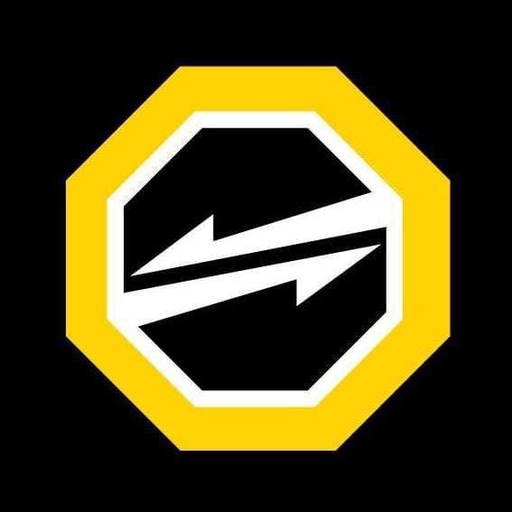
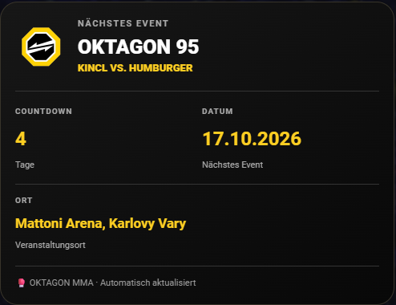
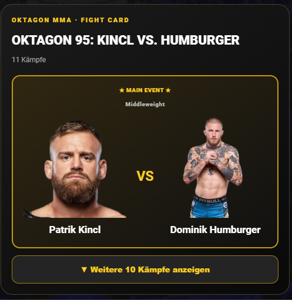
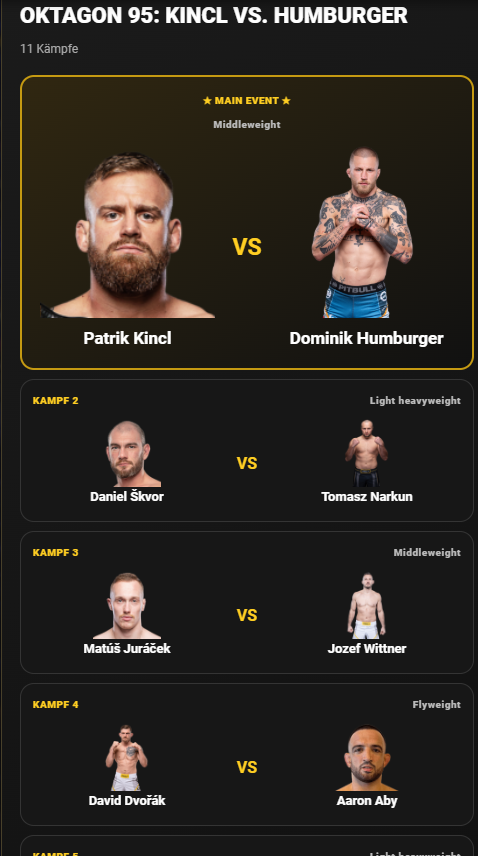

<div align="center">



# 🥊 OKTAGON MMA for Home Assistant

**Upcoming events, countdowns and official fight cards — right in your Home Assistant dashboard.**

[](https://hacs.xyz/)
[](https://github.com/fafafsb/ha-oktagon-mma/releases)
[](https://github.com/fafafsb/ha-oktagon-mma/actions)

**Two native dashboard cards. No extra frontend plugins. No YAML required to add the cards.**

</div>

---

## ✨ Features

| Feature | Description |
| --- | --- |
| 🏆 Next event | Event title, date and venue |
| ⏳ Countdown | Days remaining, updated at local midnight |
| 🗓️ Calendar | Upcoming OKTAGON events in Home Assistant |
| 🥊 Fight card | Fighter matchups, weight classes and official fighter images when available |
| ⭐ Main event | Large highlighted main event |
| 👆 Expand / collapse | Keep the main event visible and show the other bouts on demand |
| 🎨 Native dashboard cards | Select both cards from **Add card** in the dashboard |
| 🔄 Automatic updates | Event and fight data fetched from publicly available official event pages |

## 📸 Dashboard previews

### OKTAGON Event Card

A compact black-and-yellow event overview with countdown, full date (DD.MM.YYYY) and location.



### OKTAGON Fight Card

The next event's main fight is always in focus, with fighter portraits and a button to reveal the remaining bouts.



<details>
<summary>Show expanded fight card preview</summary>



</details>

## 📦 Install with HACS

1. Open **HACS** in Home Assistant.
2. Open the menu **⋮ → Custom repositories**.
3. Add `https://github.com/fafafsb/ha-oktagon-mma` and select **Integration**.
4. Download **OKTAGON MMA** (enable pre-releases in HACS if you want to test a beta).
5. **Restart Home Assistant completely.**
6. Go to **Settings → Devices & services → Add integration**, search for **OKTAGON MMA**, and complete setup.
7. Edit a dashboard, select **Add card**, search for **OKTAGON**, and choose your card.

> **No button-card, expander-card or toggle helpers required.** The integration bundles its own JavaScript cards and attempts to register them automatically. A full Home Assistant restart and browser hard refresh may be needed after installation.

## 🖼️ Dashboard cards

Choose either card directly in the Home Assistant card picker:

- **OKTAGON Event Card** — next event, days remaining, date and venue.
- **OKTAGON Fight Card** — official fighter portraits, XXL main event and expandable remaining fights.

Advanced users can also add the cards manually:

```yaml
type: custom:oktagon-event-card
```

```yaml
type: custom:oktagon-fight-card
entity: sensor.next_oktagon_fight_card
```

If the cards are not listed after a full restart, check **Settings → Dashboards → Resources** for these **JavaScript module** resources:

- `/oktagon_mma/oktagon-event-card.js`
- `/oktagon_mma/oktagon-fight-card.js`

Do not register JavaScript card files as stylesheets.

## 📊 Entities

The integration provides an upcoming-events calendar and sensors for:

- Next OKTAGON event
- Days until next event
- Next event date
- Next event location
- Next OKTAGON fight card (including matchup details in its attributes)

Entity IDs can vary if Home Assistant has renamed or suffixed them.

## ℹ️ Data and limitations

Event information and fight cards are obtained from public OKTAGON MMA pages. Event dates are **all-day calendar entries**, not confirmed start times. Fighter images and bouts depend on the official site publishing them. Website changes may temporarily interrupt parsing. Live scores, fight results and alerts are **not implemented**.

## 🐛 Issues and contributions

Found a bug or have an idea? [Open an issue](https://github.com/fafafsb/ha-oktagon-mma/issues). Please include your Home Assistant version, integration version and relevant logs where possible.

## ⚠️ Disclaimer

**Unofficial fan-made community integration.** This project is not affiliated with, sponsored by, endorsed by or officially connected to OKTAGON MMA. OKTAGON MMA trademarks, logos and fighter images belong to their respective owners.

---

<div align="center">Made for MMA fans who love Home Assistant. 🥊</div>
